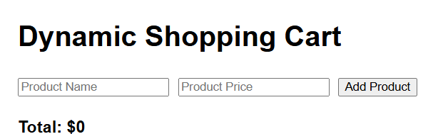
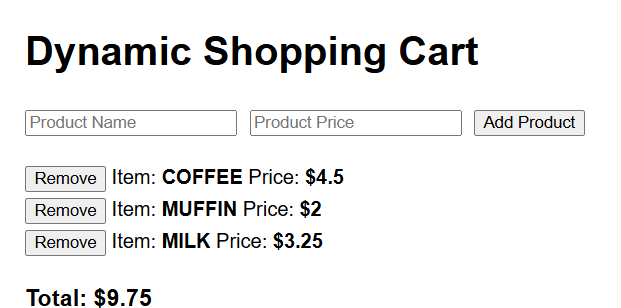
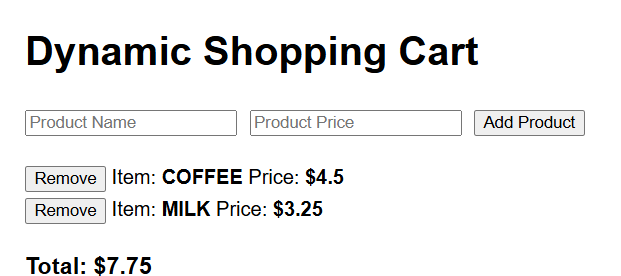

# Dynamic Shopping Cart

A page for adding products to a cart and removing them. The name, price, and running total are built in the browser. Nothing is saved, so a refresh clears the cart.

## Screenshots

**Empty cart.** The total starts at $0.

**Three products.** Each name is shown in uppercase. The total is the sum of the prices.

**After a removal.** Removing muffin subtracts $2 and leaves coffee and milk.

## How it works

- Type a product name and a price, then press **Add Product**
- The name is trimmed and stored in uppercase
- An empty name shows the message “Please the Product Name Can not be empty”
- A price of 0 or less shows the message “The Product price must be greater than 0”
- A blank price is left off the list
- **Remove** deletes that row and subtracts its price from the total
- After the first product is added, the total shows two decimal places

## Open it

Open `index.html` in a browser.

## Built with

- HTML
- CSS
- JavaScript
